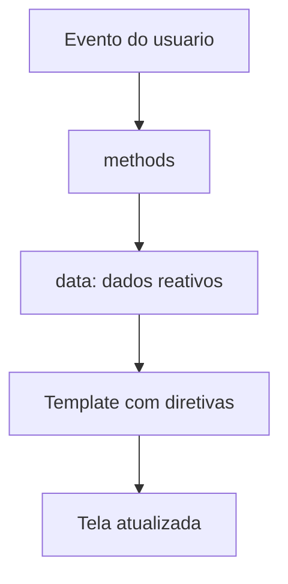



# Vue.js

<center>
    <iframe src="https://cpw2.rpmhub.dev/vuejs/slides/index.html#/"
        title="Vue.js" width="90%" height="500" style="border:none;">
    </iframe>
</center>

Esta página acompanha os slides acima, na mesma ordem, para você poder
alternar entre a explicação detalhada e o resumo visual.
{: .fs-3 }

## O que é Vue.js

Vue.js é um _framework_ JavaScript de código aberto para construir interfaces
de usuário interativas. Ele cuida da camada de visualização, a parte da
aplicação que o usuário vê e com a qual interage.
{: .fs-3 }

Uma característica importante do Vue é a **adoção incremental**. Você não
precisa reescrever o projeto inteiro para usá-lo: dá para começar controlando
apenas um pedaço de uma página que já existe e, aos poucos, ampliar o uso.
{: .fs-3 }

**Uma analogia:** se o HTML são as paredes de uma casa e o CSS é a pintura, o
JavaScript tradicional seria instalar e ligar à mão cada interruptor e cada
tomada. O Vue funciona como um sistema de automação residencial: você declara
o que deve acontecer ("quando escurecer, acenda a luz da sala") e ele mantém
tudo sincronizado sozinho.
{: .fs-3 }

Por que usar Vue?
{: .fs-3 }

* **Simplicidade:** você escreve um HTML quase normal, com alguns atributos
  especiais. A curva de aprendizado é suave.
* **Componentização:** a interface é dividida em peças reutilizáveis, como
  blocos de LEGO.
* **Ecossistema:** ferramentas oficiais como o
  [Vue Router](https://router.vuejs.org) (navegação entre páginas) e o
  [Pinia](https://pinia.vuejs.org) (gerenciamento de estado) resolvem
  necessidades comuns.
{: .fs-3 }

### Reatividade

A grande ideia do Vue é a **reatividade**: quando um dado muda, a tela se
atualiza sozinha. Pense em uma planilha eletrônica. Ao alterar o valor de uma
célula, todas as fórmulas que dependem dela são recalculadas automaticamente.
{: .fs-3 }

Sem Vue, cada mudança exige que você encontre o elemento e altere o conteúdo:
{: .fs-3 }

```javascript
document.getElementById("msg").innerText = "novo valor";
```
{: .fs-3 }

Com Vue, você só altera a variável. O Vue sabe quais partes da tela dependem
dela e as atualiza. O ciclo completo fica assim:
{: .fs-3 }


{: .fs-3 }

Os dados ficam em `data()`. O template (o HTML) mostra esses dados. Quando o
usuário clica ou digita, um método altera os dados, e a tela acompanha.
{: .fs-3 }

## Hello Vue

O primeiro exemplo exibe a mensagem "Hello Vue in CPW2!" na tela:
{: .fs-3 }

```html
<!DOCTYPE html>
<html lang="pt-br">
<head>
    <meta charset="UTF-8">
    <title>Hello Vue</title>
    <script src="https://cdn.jsdelivr.net/npm/vue/dist/vue.global.min.js">
    </script>
</head>
<body>
    <div id="app">
        <h1>{{ message }}</h1>
    </div>
    <script>
        const app = Vue.createApp({
            data() {
                return {
                    message: 'Hello Vue in CPW2!'
                }
            }
        })
        app.mount('#app')
    </script>
</body>
</html>
```
{: .fs-3 }

Vamos ler o exemplo por partes:
{: .fs-3 }

1. **Importação via CDN:** a tag `<script src="...vue.global.min.js">` carrega
   o Vue direto da internet. Nada precisa ser instalado, o que é ótimo para
   aprender e prototipar.
2. **O território do Vue:** a `<div id="app">` é a região que o Vue controla.
   Fora dela, a página continua sendo HTML comum.
3. **Interpolação `{{ message }}`:** as chaves duplas (os "bigodes", do inglês
   _mustache_) dizem ao Vue: "coloque aqui o valor de `message`". Se o valor
   mudar, o texto muda junto.
4. **`Vue.createApp({...})`:** cria a aplicação. A função `data()` devolve um
   objeto com os dados reativos. Ela é uma função, e não um objeto direto,
   para que cada componente receba a sua própria cópia dos dados.
5. **`app.mount('#app')`:** liga a aplicação à `div`. Antes dessa linha, o Vue
   existe na memória, mas ainda não controla nada na página.
{: .fs-3 }

## Diretivas

Diretivas são atributos especiais que o Vue acrescenta ao HTML. Todas começam
com `v-` e dizem ao Vue como aquele elemento deve se comportar. As principais
são:
{: .fs-3 }

* `v-bind`: liga um atributo HTML a um dado.
* `v-model`: liga um campo de formulário a um dado nos dois sentidos.
* `v-if` e `v-else`: mostram ou removem um elemento conforme uma condição.
* `v-for`: repete um elemento para cada item de uma lista.
* `v-on`: executa um método quando acontece um evento, como um clique.
{: .fs-3 }

As próximas seções mostram cada uma delas em um exemplo pequeno e completo.
{: .fs-3 }

## v-model: ligação de mão dupla

A diretiva `v-model` conecta um campo de formulário a uma variável. A ligação
vale nos dois sentidos: o que o usuário digita vai para a variável, e o que o
código coloca na variável aparece no campo. É como um espelho.
{: .fs-3 }

```html
<div id="app">
    <p>{{ message }}</p>
    <p><input v-model="message"></p>
</div>

<script>
    const app = Vue.createApp({
        data() {
            return { message: 'Hello Vue.js in CPW2!' }
        }
    })
    app.mount('#app')
</script>
```
{: .fs-3 }

Ao digitar no `<input>`, o parágrafo acima muda letra por letra. Nenhum código
de evento foi escrito. Em JavaScript puro, seria preciso ouvir o evento
`input`, ler o valor do campo e escrever esse valor no parágrafo.
{: .fs-3 }

## v-for: listas

A diretiva `v-for` cria um elemento para cada item de um array. É um laço de
repetição escrito direto no HTML.
{: .fs-3 }

```html
<div id="app">
    <ul>
        <li v-for="x in task">
            {{ x.text }}
        </li>
    </ul>
</div>

<script>
    const app = Vue.createApp({
        data() {
            return {
                task: [
                    { text: 'Learn JavaScript' },
                    { text: 'Learn Vue.js' },
                    { text: 'Build Something Awesome' }
                ]
            }
        }
    })
    app.mount('#app')
</script>
```
{: .fs-3 }

Leia `v-for="x in task"` como "para cada elemento `x` dentro do array
`task`". Três objetos no array geram três `<li>` na tela. Se um item for
acrescentado ou removido do array, a lista se atualiza sozinha.
{: .fs-3 }

## v-if e v-else: renderização condicional

A diretiva `v-if` mostra um elemento apenas quando a condição é verdadeira. O
`v-else`, colocado logo depois, mostra a alternativa. É um `if/else` aplicado
ao HTML.
{: .fs-3 }

```html
<div id="app">
    <h1 v-if="show">Vue é incrível!</h1>
    <h1 v-else>Oh não 😢</h1>

    <template v-if="show">
        <p>Parágrafo 1</p>
        <p>Parágrafo 2</p>
    </template>
</div>

<script>
    const app = Vue.createApp({
        data() {
            return { show: true }
        }
    })
    app.mount('#app')
</script>
```
{: .fs-3 }

Com `show` igual a `true`, aparece "Vue é incrível!". Com `false`, aparece
"Oh não". A tag `<template>` aplica a condição a um grupo de elementos sem
criar um elemento extra na página.
{: .fs-3 }

Um detalhe importante: `v-if` **remove** o elemento do DOM quando a condição é
falsa. Se a ideia for apenas esconder, mantendo o elemento no DOM, use
`v-show`. O `v-show` só troca o estilo `display` do elemento, o que é mais
barato quando algo aparece e some muitas vezes.
{: .fs-3 }

## v-on: eventos

A diretiva `v-on` faz o Vue reagir a eventos do usuário: cliques, teclas,
movimentos do mouse. A forma `v-on:click` tem um atalho muito usado, `@click`.
{: .fs-3 }

```html
<div id="app">
    <button v-on:click="execute">Try</button>
</div>

<script>
    const app = Vue.createApp({
        data() {
            return {}
        },
        methods: {
            execute(event) {
                alert(event.target.tagName)
            }
        }
    })
    app.mount('#app')
</script>
```
{: .fs-3 }

`v-on:click="execute"` significa "quando este botão for clicado, chame o
método `execute`". Os métodos ficam no objeto `methods`. O parâmetro `event` é
o evento nativo do navegador, e `event.target` é o elemento clicado (aqui, o
`BUTTON`).
{: .fs-3 }

Dentro de um método, `this` dá acesso aos dados de `data()`. É assim que um
evento altera o estado da aplicação:
{: .fs-3 }

```html
<div id="app">
    <p>Cliques: {{ total }}</p>
    <button @click="contar">Clique aqui</button>
</div>

<script>
    const app = Vue.createApp({
        data() {
            return { total: 0 }
        },
        methods: {
            contar() {
                this.total++
            }
        }
    })
    app.mount('#app')
</script>
```
{: .fs-3 }

## v-bind: atributos dinâmicos

A interpolação `{{ }}` funciona apenas no conteúdo dos elementos, não dentro
de atributos. Para que um atributo receba um valor vindo dos dados, use
`v-bind`. O atalho é o sinal de dois pontos: `:src` é o mesmo que
`v-bind:src`.
{: .fs-3 }

```html
<div id="app">
    
    <button :disabled="bloqueado">Enviar</button>
</div>

<script>
    const app = Vue.createApp({
        data() {
            return {
                foto: 'https://vuejs.org/images/logo.png',
                descricao: 'Logo do Vue',
                bloqueado: true
            }
        }
    })
    app.mount('#app')
</script>
```
{: .fs-3 }

Sem os dois pontos, `src="foto"` seria o texto literal "foto". Com `:src`, o
Vue lê a variável `foto` e usa o seu valor. Trocar `bloqueado` para `false`
habilita o botão.
{: .fs-3 }

## Resumo das diretivas

| Diretiva | Função | Atalho |
|----------|--------|--------|
| `v-bind` | Liga um atributo HTML a um dado | `:` |
| `v-model` | Ligação de mão dupla com campos de formulário | |
| `v-if` / `v-else` | Renderização condicional | |
| `v-for` | Repete um elemento para cada item de uma lista | |
| `v-on` | Reage a eventos do DOM | `@` |
{: .fs-3 }

## Ciclo de vida

Todo componente Vue passa por fases, da criação até a remoção da página, assim
como um ser vivo nasce, cresce e morre. Em cada fase o Vue chama funções
especiais, os **ganchos** (_hooks_), onde você pode colocar código.
{: .fs-3 }

1. **Criação** (`beforeCreate`, `created`): o Vue prepara dados e métodos.
2. **Montagem** (`beforeMount`, `mounted`): o componente é inserido no DOM.
3. **Atualização** (`beforeUpdate`, `updated`): o DOM é atualizado depois que
   um dado muda.
4. **Desmontagem** (`beforeUnmount`, `unmounted`): o componente sai do DOM.
{: .fs-3 }

Os ganchos mais usados no dia a dia:
{: .fs-3 }

* `created`: os dados já existem, mas nada foi desenhado na tela. Bom lugar
  para começar a buscar dados de uma API.
* `mounted`: o componente já está visível. Bom lugar para acessar elementos do
  DOM, por exemplo para dar foco a um campo.
* `updated`: roda a cada atualização da tela. Cuidado: alterar dados aqui pode
  gerar um laço infinito de atualizações.
* `unmounted`: hora de limpar a casa, parando timers (`clearInterval`) e
  removendo ouvintes de eventos. Esquecer essa limpeza deixa código rodando
  para um componente que não existe mais.
{: .fs-3 }

Os ganchos são declarados como funções no mesmo objeto de `data()` e
`methods`:
{: .fs-3 }

```javascript
const app = Vue.createApp({
    data() {
        return { segundos: 0, timer: null }
    },
    mounted() {
        this.timer = setInterval(() => this.segundos++, 1000)
    },
    unmounted() {
        clearInterval(this.timer)
    }
})
app.mount('#app')
```
{: .fs-3 }

Quando a aplicação aparece na tela, `mounted` inicia um cronômetro. Se ela for
removida, `unmounted` para o cronômetro.
{: .fs-3 }

## Integração com a Fetch API

A [Fetch API](https://developer.mozilla.org/pt-BR/docs/Web/API/Fetch_API) já
vem no navegador: não precisa de biblioteca extra. Ela funciona como um
carteiro: leva o pedido ao servidor e traz a resposta de volta. Cada chamada
de `fetch` devolve uma **Promise**, o mesmo conceito estudado na aula de
[Promise](https://cpw2.rpmhub.dev/promise/promise.html).
{: .fs-3 }

```html
<head>
    <script src="https://cdn.jsdelivr.net/npm/vue/dist/vue.global.min.js"></script>
</head>
<body>
    <div id="app">
        <button v-on:click="getData">Load data</button>
        <ul>
            <li v-for="x in tasks">
                {{ x.text }}
            </li>
        </ul>
    </div>

    <script>
        const app = Vue.createApp({
            data() {
                return { tasks: [] }
            },
            methods: {
                getData() {
                    fetch("data.json")
                        .then(response => response.json())
                        .then(data => (this.tasks = data))
                }
            }
        })
        app.mount('#app')
    </script>
</body>
```
{: .fs-3 }

O fluxo, passo a passo:
{: .fs-3 }

1. O usuário clica em "Load data", e o `v-on:click` chama `getData`.
2. `fetch("data.json")` faz a requisição e devolve uma Promise.
3. O primeiro `.then()` recebe o objeto `Response`. `response.json()` lê o
   corpo e devolve outra Promise, já convertida em objeto.
4. O segundo `.then()` coloca esses dados em `this.tasks`. Como `tasks` é
   reativo, o `v-for` desenha a lista na tela.
{: .fs-3 }

O mesmo método pode ser escrito com `async`/`await`, que você já conhece:
{: .fs-3 }

```javascript
methods: {
    async getData() {
        try {
            let response = await fetch("data.json")
            this.tasks = await response.json()
        } catch (erro) {
            console.error(erro)
        }
    }
}
```
{: .fs-3 }

Para o `fetch` conseguir ler o `data.json`, abra a página por um servidor
local (por exemplo, a extensão Live Server do VS Code), e não pelo arquivo
direto no navegador.
{: .fs-3 }

## Próximos passos

Quando a aplicação cresce, o próximo passo é organizar a interface em
[componentes](https://cpw2.rpmhub.dev/vuejs/components.html), inclusive em
arquivos `.vue`. Em projetos maiores, o
[Nuxt.js](https://cpw2.rpmhub.dev/vuejs/nuxt.html) entra com roteamento,
páginas e estrutura de projeto.
{: .fs-3 }

## Exercícios de Fixação Práticos

Os exercícios abaixo são progressivos: cada um acrescenta uma peça ao
anterior. Use uma página HTML simples com o Vue carregado por CDN, como no
Hello Vue, e confira o resultado direto na tela. Se travar em algum, volte à
seção indicada entre parênteses.
{: .fs-3 }

1. **Minha primeira aplicação** (Hello Vue)

    Crie uma página com uma `<div id="app">` e uma aplicação Vue com um dado
    `nome` contendo o seu nome. Mostre na tela a frase `Olá, {{ nome }}!`
    dentro de um `<h1>`. Depois, troque o valor de `nome` no código e recarregue
    a página para ver a mudança.

2. **O espelho** (v-model)

    Acrescente um `<input>` ligado a `nome` com `v-model`. Ao digitar no campo,
    o `<h1>` do exercício anterior deve mudar a cada letra.

3. **Atributo dinâmico** (v-bind)

    Crie um dado `corDoTexto` com o valor `"blue"` e use
    `:style="{ color: corDoTexto }"` no `<h1>`. Acrescente um segundo `<input>`
    ligado a `corDoTexto` com `v-model` e teste digitar `red`, `green` ou
    `orange`.

4. **Mostrar e esconder** (v-if, v-else e v-on)

    Crie um dado `visivel` com valor `true` e um botão com
    `@click="visivel = !visivel"`. Quando `visivel` for verdadeiro, mostre um
    parágrafo com uma dica de estudo; quando for falso, mostre
    "Dica escondida". Depois troque `v-if` por `v-show` e observe, no
    inspetor do navegador, a diferença no DOM.

5. **Lista de frutas** (v-for)

    Crie um dado `frutas` com o array `["Maçã", "Banana", "Uva"]`. Use `v-for`
    para mostrar cada fruta em um `<li>` dentro de uma `<ul>`. Acrescente uma
    quarta fruta no array e confira que a lista cresce sem mexer no HTML.

6. **Contador** (v-on e methods)

    Crie um dado `total` começando em 0 e dois botões: "+1" e "Zerar". Cada
    botão chama um método diferente em `methods` (`somar` e `zerar`), que
    altera `this.total`. Mostre o total na tela.

7. **Lista de tarefas** (v-model, v-on, v-for e v-if juntos)

    Crie um `<input>` ligado a `novaTarefa` e um botão "Adicionar". Ao clicar,
    um método coloca o texto no array `tarefas` com `push` e limpa o campo. Mostre
    as tarefas com `v-for`. Quando o array estiver vazio, mostre com `v-if` a
    mensagem "Nenhuma tarefa cadastrada". Como desafio extra, ignore textos
    vazios e acrescente um botão "Remover" em cada `<li>` usando `splice`.

8. **Tarefas vindas de um JSON** (Fetch API)

    Crie um arquivo `tarefas.json` na mesma pasta da página, por exemplo
    `[{ "texto": "Estudar Vue" }, { "texto": "Fazer os exercícios" }]`. Crie um
    botão "Carregar" que chama um método com `fetch("tarefas.json")`. No
    primeiro `.then()`, converta a resposta com `response.json()`. No segundo,
    guarde os dados em `tarefas` e mostre a lista com `v-for`. Abra a página
    por um servidor local.

9. **Carregar sem clicar** (ciclo de vida e async/await)

    Reescreva o exercício 8 sem o botão: faça a requisição no gancho
    `mounted`, usando `async`/`await` e `try`/`catch`. Se a requisição falhar
    (teste trocando o nome do arquivo), mostre com `v-if` a mensagem
    "Não foi possível carregar as tarefas".

Depois de concluir estes exercícios, siga para os
[Exercícios de projeto sobre Vue.js](https://cpw2.rpmhub.dev/exercicios/vue.html),
que constroem um CRUD completo com componentes e uma API.
{: .fs-3 }

## Exercício de Fixação Teórico

<center>
    <iframe src="https://cpw2.rpmhub.dev/vuejs/slides/questions.html"
        title="Exercício de Fixação Teórico sobre Vue.js" width="90%" height="500"
        style="border:none;">
    </iframe>
</center>

## Referências

* [O que é Vue.js?](https://www.w3schools.com/whatis/whatis_vue.asp) no W3Schools

* [Vue.js](https://vuejs.org): The Progressive JavaScript Framework

* [Fetch API](https://developer.mozilla.org/pt-BR/docs/Web/API/Fetch_API): requisições HTTP nativas do navegador



<center>
<a href="https://rpmhub.dev" target="blanck"></a><br/>
<a rel="license" href="http://creativecommons.org/licenses/by/4.0/">CC BY 4.0 DEED</a>
</center>
